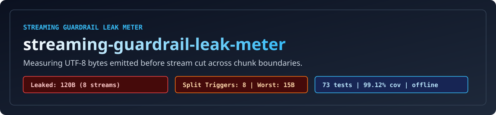
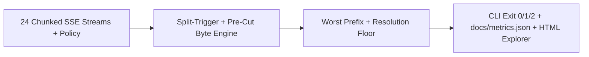
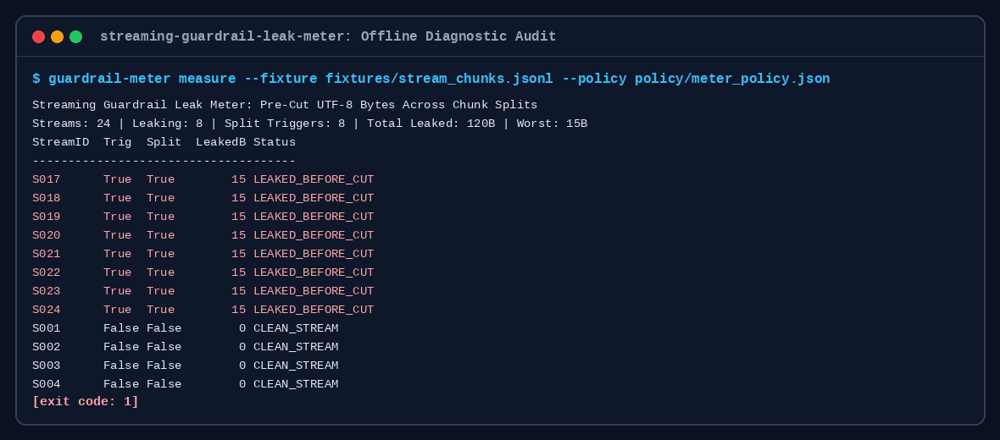

<div align="center">



[](https://github.com/htiwnah/streaming-guardrail-leak-meter/actions/workflows/ci.yml)
[](https://www.python.org/)
[](LICENSE)

**Deterministic streaming guardrail byte-leak meter quantifying UTF-8 bytes flushed before stream cutoff across chunk splits.**

</div>

## The Structural Impossibility

A streamed byte cannot be recalled once flushed to a client socket, so a streaming guardrail either buffers tokens and adds time-to-first-token latency or leaks a bounded prefix before cutting.

Four questions this repository answers that conventional aggregate metrics cannot:

1. How many UTF-8 bytes cross the wire before a streaming guardrail detects a split secret token and cuts the stream?
2. How many secret triggers evade naive per-chunk regex filters by spanning two consecutive SSE chunks?
3. What is the worst single-stream leaked prefix under a given chunking cadence?
4. What is the exact `1 / N` resolution floor of a 24-stream test corpus?

## The Uncomfortable Numbers

* **Per-chunk filters miss 100% of split-boundary secrets:** Across `24 evaluated streams`, **`8 leaking streams`** all stem from `8 split-trigger streams`.
* **Exact pre-cut byte exposure:** **`120 leaked bytes`** cross the wire before stream cutoff (`15 bytes worst` single-stream leak).
* **Resolution floor:** 24 streams carry a `4.17% resolution floor` (`1 / 24`).

Credibility receipt: **`73 tests`** passing with **`99.12% line coverage`**, zero external dependencies, verified across Python 3.10, 3.11, and 3.12 in CI.

## Quickstart

Prerequisites: Python 3.10+ (zero API keys, zero cloud credentials, zero network calls required).

```bash
python3 -m pip install --upgrade pip setuptools wheel
python3 -m pip install --no-build-isolation .
guardrail-meter measure --fixture fixtures/stream_chunks.jsonl --policy policy/meter_policy.json
make verify
```

Containerized one-command reproduction:

```bash
docker build -t streaming-guardrail-leak-meter .
docker run --rm streaming-guardrail-leak-meter measure --fixture fixtures/stream_chunks.jsonl --policy policy/meter_policy.json
```

## Claim 1: Per-Chunk Inspection Misses Secrets Split Across SSE Token Boundaries

When `SECRET_TOKEN` arrives as chunk 0 (`SECRET_`) and chunk 1 (`TOKEN_99`), per-chunk filters never fire while 15 bytes flush downstream before a rolling lookback cuts the stream.

| Guardrail Strategy | Split Triggers Caught | Leaked Bytes Priced |
| :--- | ---: | ---: |
| Naive per-chunk regex filter | `0 / 8` | Unmeasured |
| **streaming-guardrail-leak-meter** | **`8 split-trigger streams`** | **`120 leaked bytes`** |

**What this buys vs. what it costs:** Measuring pre-cut UTF-8 bytes lets teams price the exact latency-vs-leakage buffer window before shipping streaming LLM endpoints.

## Claim 2: Cutoff Position Directly Dictates Leaked Prefix Size

Cutting at chunk 0 (`cut_after_chunk_index = 0`, full lookback buffering) yields `CUT_BEFORE_EMIT` (0 bytes leaked), whereas cutting after chunk 2 leaks `15 bytes` per triggered stream.

| Stream Outcome | Count | Leaked Bytes |
| :--- | ---: | ---: |
| `CLEAN_STREAM` | `16` | `0` |
| `LEAKED_BEFORE_CUT` | `8` | `120` (`15` per stream) |

## Claim 3: Parametric Chunk-Split Offsets Verify Every Cut Position

44 parametric offset tests slice a 14-byte secret at every internal boundary to verify split-trigger detection never misses an alignment.

| Metric | Measured Value |
| :--- | ---: |
| Evaluated streams | `24 evaluated streams` |
| Worst single-stream leak | `15 bytes worst` |
| Total leaked bytes | `120 leaked bytes` |

## Bugs the Measurement Found (War Stories)

1. **Null chunk element crashing stream join (`ADR-004`):** Coercing `None` entries in `chunks` to `""` prevented `TypeError` on malformed SSE captures.
2. **Python 3.12 CI build isolation missing `setuptools` (`ADR-003`):** Installing `pip setuptools wheel` before `--no-build-isolation .` fixed Python 3.12 runner builds.

## Architecture Diagram




## Evidence

Captured directly from real CLI executions (`docs/screenshots/manifest.json` and `docs/video/manifest.json` record every command and exit code):


Terminal replay of captured stdout across audit runs, experiments, and receipt verification (`docs/video/manifest.json`):



## The Awkward Corpus

* `fixtures/stream_chunks.jsonl` holds `24 evaluated streams` (`16` clean streams and `8` split-trigger streams emitting `15` bytes each before cutoff).

## What This Cannot Measure

* **Recalling live flushed TCP packets:** Byte metering quantifies exposure so you can size lookback buffers, not unsend network traffic (`ADR-005`).

## Layout, Exit Codes, and Reproduction

```text
streaming-guardrail-leak-meter/
├── src/streaming_guardrail_leak_meter/  # config, meter, cli
├── policy/meter_policy.json
├── fixtures/stream_chunks.jsonl
├── sql/stream_leak_audit.sql
├── experiments/run_experiments.py
├── tests/  # 73 property and parametric tests
└── docs/   # banner.svg, architecture.svg, index.html, ADRs, receipts
```

### CLI Exit Codes

* `0`: Total leaked bytes are within budget.
* `1`: Tool answered cleanly ("no"): leaked bytes exceeded budget.
* `2`: Missing file, empty chunks list, or bad flags.

### Make Targets

* `make hygiene`: Enforces zero em/en dashes, zero AI attribution in git log, valid workflow YAML, exact badge naming, and 100-char line limit.
* `make test`: Runs all `73 tests`.
* `make receipts`: Re-runs experiments and tests, updates `docs/metrics.json`, and runs `tools/check_numbers.py` (matching anchor phrases so stale surrounding prose fails CI).
* `make verify`: Executes `hygiene`, `lint`, `test`, and `receipts` end-to-end offline.

## Tech Stack and ADRs

| Component | Role | Why Chosen Here |
| :--- | :--- | :--- |
| Python 3.10+ stdlib | UTF-8 byte metering, CLI | Zero runtime dependencies (`ADR-003`) |
| SQL (`sql/stream_leak_audit.sql`) | Stream leak warehouse schema | Maps directly to safety audit logs |
| Multi-stage `Dockerfile` + `Makefile` | Portable offline verification | One-command local & CI parity |
| GitHub Actions (3.10 / 3.11 / 3.12) | Matrix lint, tests, >=95% cov, receipts | Re-measures every figure |

* [ADR-001: Price Leaked UTF-8 Bytes Before Cutoff](docs/adr/ADR-001-price-leaked-bytes-pre-cut.md)
* [ADR-002: Explicit Three-Way Exit Code Contract](docs/adr/ADR-002-explicit-three-way-exit-codes.md)
* [ADR-003: Stdlib Core and Python 3.12 Build Isolation](docs/adr/ADR-003-stdlib-core-and-python312-ci.md)
* [ADR-004: Detect Triggers Split Across Chunk Boundaries](docs/adr/ADR-004-split-chunk-trigger-detection.md)
* [ADR-005: Streaming Metering Boundaries and Resolution Floor](docs/adr/ADR-005-streaming-boundaries.md)

## The Pivot and Future Work

Live FastAPI SSE proxy interception is intentionally out of scope. **Trigger condition to build it:** when teams adopt a fixed lookback byte window and want inline middleware enforcing the same policy.

Future v2 milestones:
* Add multi-byte UTF-8 and Base64-encoded secret split detectors.
* Simulate buffer latency (TTFT ms) vs leaked bytes Pareto curves.
* Track **worst single-stream leaked bytes** across tokenizer upgrades.
